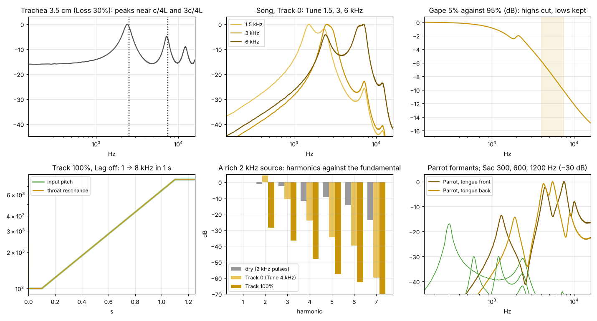
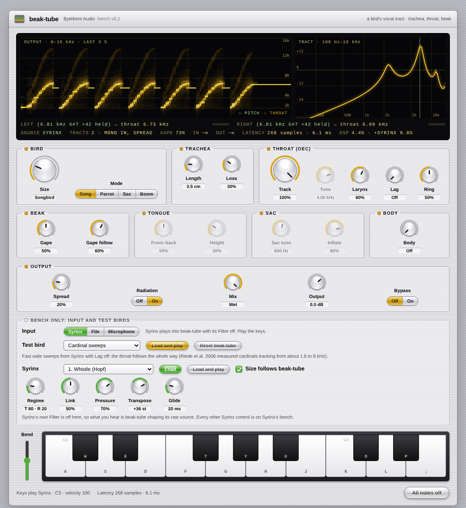
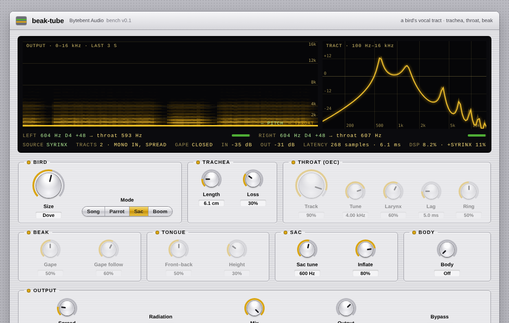

# beak-tube · tests

Quick results per batch: tests, experiments and pictures. Pictures live in `docs/tests/`. Run the
tests with `node tests/engine-test.js`.

**Now: 30 engine tests passing** (about 15 s). Benchmark: `node tools/perf.js`. Levels:
`node tools/calibrate.js`.

## Batch 02 · Song chain

- Trachea: a delay line with an inverting reflection at the open end (closed–open tube). 3.5 cm
  peaks at 2467 and 7400 Hz (2.5 and 7.5 kHz expected; the wall-loss low-pass pulls them down
  slightly). Size 1 makes it 4× longer: 627 Hz. ✓
- Perl et al.'s printed values (larynx 30, cavity 2 × 10⁻⁸ / 350) give 3844 Hz as a Helmholtz
  resonance, their OEC average of about 4 kHz, so the units do check out with the larynx as the
  neck and the cavity as the volume. ✓
- Song circuit: larynx (Lg) → cavity (Ch) → beak (Lb, Rb), three states, trapezoidal rule
  prewarped at the resonance, coefficients per sample (Lag runs inside the block). With Track 0
  the peak sits at Tune: 1506, 2965, 5947 Hz for 1.5, 3, 6 kHz. ✓
- Larynx 0.2 → 1951 Hz, 1 → 4488 Hz around Tune 3 kHz: a smaller opening lowers the resonance. ✓
- Gape 5% against 95%: −1.6 dB below 2.5 kHz, −8.1 dB over 4–7.5 kHz, as in the towhee. ✓
- Ring 0.1 → 0.9: peak over 1.5 kHz from 4.7 to 24.9 dB. ✓
- `response()` (the bench's curve) against measurement: within 2.7 dB from 0.5 to 8 kHz. ✓

Problems found and fixed:

- Perl's printed beak radiation resistance (100 000 against an inertance of 1000) puts the beak's
  corner at 16 Hz. Gape now sets the corner directly (2 to 16 kHz, ÷ Size) and the resistance
  follows from it.
- Perl's cavity loss (1000) gives a Q of several hundred. Ring sets Q instead (0.8 to 24, log).
- Radiation normalised at 2 kHz made Sac 20 dB and Boom 35 dB quieter than dry: it is now
  normalised at each mode's own band (2 kHz ÷ Size for Song and Parrot, Sac tune for Sac and Boom).

## Batch 03 · tracking

The tracker is YIN (de Cheveigné & Kawahara 2002) on the input, in two bands:

| Band | Rate | Pitch | Window | Input low-pass |
|---|---|---|---|---|
| Low | about 12 kHz | 55–850 Hz | 10.7 ms | 2 kHz |
| High | about 96 kHz (2× upsampled below 64 kHz) | 0.8–14 kHz | 2.5 ms | 12 kHz |

Experiments that led there:

- One band at 24 kHz failed on bird sweeps: a period of 7.5 samples dips less at 7 or 8 than at
  15, so it jumped an octave down. The high band now runs at about 96 kHz, and a half-period
  check takes the half when it dips nearly as well.
- Narrow pulses generated at 48 kHz are not periodic sample by sample (aliased). The test source
  is now band-limited (harmonics up to 0.45 × sr), like Syrinx's decimated output.
- The high band's 2.5 ms window can sit in the gap between low pulses and find a false period;
  it is ignored when its window holds under 30% of the low band's mean square. When both bands
  are sure, the deeper dip wins.

Results (Lag off, mean / worst):

| Rate | 1 → 8 kHz in 1 s | 8 → 1 kHz in 0.1 s | 120 → 900 Hz in 1 s |
|---|---|---|---|
| 44.1 kHz | 1.4 / 10 ct | 2.8 / 19 ct | 4.2 / 16 ct |
| 48 kHz | 1.4 / 9 ct | 2.8 / 20 ct | 4.1 / 16 ct |
| 96 kHz | 0.6 / 5 ct | 1.9 / 19 ct | 4.9 / 17 ct |

- Lag 5 ms trails a 3 oct/s sweep by 16 cents. ✓
- Track 100% turns a rich source into a pure tone: content 2.05 → 1.00 at 2 kHz, 2.06 → 1.09 at
  1 kHz (1 is a pure tone). ✓
- Noise, then silence: the cavity holds 2000 Hz throughout. ✓
- Stereo in: left 1.5 kHz and right 3 kHz each track their own. Mono in with Spread 0 gives
  identical sides; Spread 0.5 makes them differ. ✓
- Fixed latency: one 32-sample block plus the tracker's look-ahead: 268 samples at 44.1 kHz,
  288 at 48 kHz, 544 at 96 kHz (about 6 ms). The dry signal arrives exactly that late. ✓
- Same output at buffer sizes 1, 64, 128 and 1000. ✓
- At 32 kHz the high band still slips an octave near 8 kHz. Not tested; rare in DAWs.

On Syrinx's own output (vendored engine, Filter off, Track 100%, Lag off), against the pitch
Syrinx is commanding on its loudest side:

| Syrinx preset | Tracker sure | Error median / 90% |
|---|---|---|
| Link (finch fingerprint) | 93% | 19 / 29 ct |
| Cardinal sweeps | 76% | 24 / 32 ct |
| Buzz (SNILC) | 89% | 20 / 36 ct |
| Screech (Chaos) | 95% | 20 / 29 ct |
| Canary trill | 56% | 33 / 83 ct |
| Two voices | 72% | follows one of them, not always the loudest |

The 20-cent median is probably Syrinx's sounding pitch against its commanded one (Grain); the
cavity's peak is far wider than that. Two voices at once is beyond one tracker, as expected.

## Batch 04 · modes

- Parrot (trachea 1.5 cm): formants at 1.60, 4.34, 6.45 and 9.53 kHz, inside Beckers et al.'s
  ranges. Tongue front → back: F3 7.58 → 5.50 kHz, F1 1301 → 1898 Hz. Height lowers F1 by 12 dB. ✓
- With the default 3.5 cm trachea, the tube's own 7.4 kHz peak masks F3's movement. The test bird
  on the bench uses 1.5 cm.
- Sac peaks at 299, 604 and 1201 Hz for Sac tune 300, 600 and 1200 Hz. ✓ Its soft wall needed two
  poles and the closed-beak leak was cut to 10%: at 300 Hz the trachea's 2.4 kHz peak won before.
- Boom peaks at Sac tune ÷ 16 (37.5 Hz). Its body now rings with the sac rather than at 100 Hz. ✓
- Body adds 17 dB at 400 Hz. ✓
- Each mode matches the dry level within 1 dB, Radiation on and off. ✓
- No NaN or runaway across extreme settings and inputs (loudest peak 4.4). ✓
- Silence: exact zero, idle, wakes up. ✓

## Batch 05 · bench

`tools/beak-tube.html`: Syrinx (vendored, Filter off) plays into beak-tube from the keyboard, or
a file or the microphone goes in. The spectrogram shows the tracked pitch (green) and the throat
resonance (yellow); the curve on the right is the tract's response with the pitch marked. Five
test birds load beak-tube settings with a Syrinx preset and phrase.

Dove coo test bird (Sac at the Dove size):

Headless check: no console errors; Syrinx at C3 (2.09 kHz) → throat 2.21 kHz at Track 90% (Tune
4 kHz pulls it up a little, as designed); fits a 390 px phone without sideways scrolling.

`tools/perf.js` (one 2.1 GHz Xeon core, 48 kHz):

| Scenario | CPU |
|---|---|
| Silent (idle) | 0.1% |
| Mono in, Song, Spread 0 | 4.4% |
| Mono in, Song, defaults (two tracts) | 5.0% |
| Stereo in, Song (two trackers) | 9.5% |
| Stereo in, Parrot | 10.0% |
| Stereo in, Sac | 11.3% |
| Stereo in, Boom, crane, 200 cm | 8.1% |

The tracker's high band is most of it (about 3.5% per channel).

**You:** listening round on the bench.
